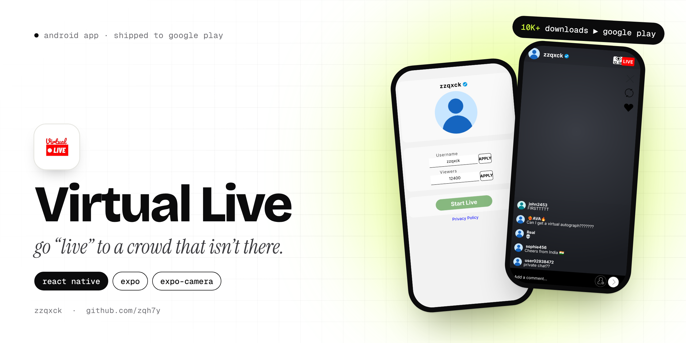
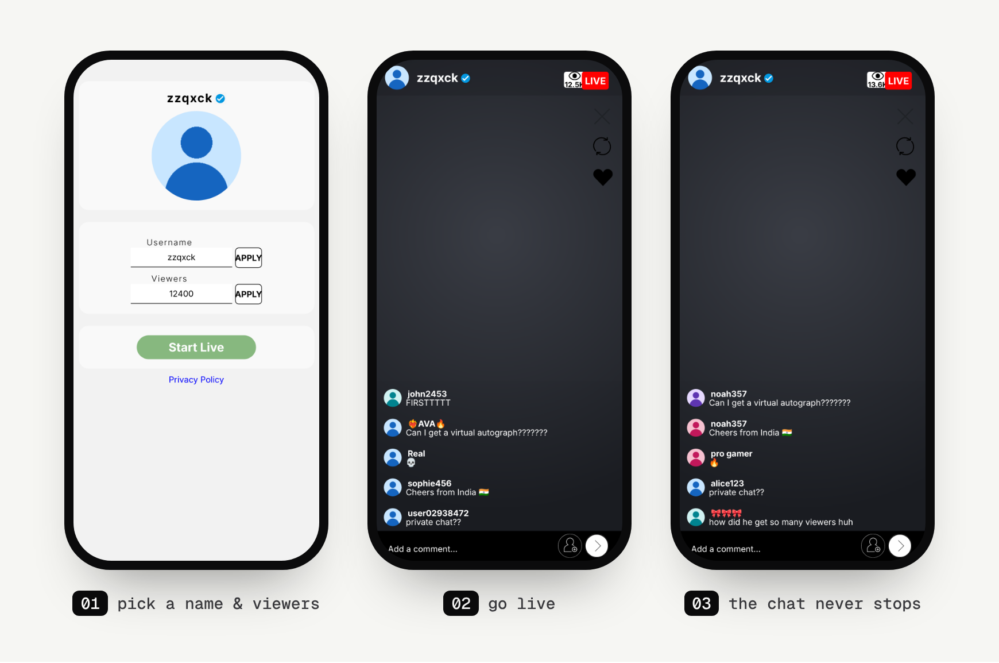

<p align="center">
  
</p>

<p align="center">
  
  
  
  
</p>

# Virtual Live

Virtual Live makes it look like you're streaming live to thousands of people. You type a username, pick how many viewers you want and hit **Start Live**. Your camera fills the screen, and on top of it you get a verified badge, a viewer counter and a chat full of people who don't exist.

It's made for pranks and short videos: fool a friend, film your reaction, or just see what being "famous" feels like for a minute. It went up on Google Play as **Virtual Live: Famous Fake Live** and passed **10,000 downloads**, the most of any app I've released.

The repo is still called `fakeLive` because that was the working name before the store listing existed.

## Screens

<p align="center">
  
</p>

## What it does

- **Your camera, live.** The front camera runs full screen behind everything. Tap the flip icon to switch to the back camera.
- **A viewer count you choose.** Start anywhere from 1,000 up. Every 5 seconds the number drifts up or down by as much as 10%, so it never looks frozen, and big numbers are shortened the way real apps do it (12400 becomes 12.4K).
- **A chat that keeps going.** Every 1.5 seconds a new batch of comments slides in, mixed from 20 fake usernames and 30 messages ("FIRSTTTTT", "whats ur insta?" and a lot of 💀).
- **Your own profile.** Pick a profile picture from your gallery. Tap it during the live to open a profile card with followers, likes and following.
- **It remembers you.** Your username and picture are saved on the phone, so the next live is one tap away.
- **Privacy policy screen** inside the app, as the Play Store requires.

Nothing gets recorded or uploaded. The camera is only a preview on your own screen, so if you want to keep a clip, use your phone's screen recorder.

## How it's built

| Part | Tech |
|---|---|
| Framework | React Native 0.72, Expo SDK 49 |
| Camera | `expo-camera` |
| Navigation | React Navigation (stack) |
| Storage | `@react-native-async-storage/async-storage` |
| Profile picture | `expo-image-picker` |
| Release | EAS Build, published on Google Play |

There are four screens: `Start`, `Live`, `Profile` and `Privacy`. The fake usernames and messages live in `fakeData.js`. The live screen runs two timers, one for the viewer drift and one that adds three random comments and keeps only the newest few on screen, which is what makes the chat feel busy without ever piling up.

## Run it yourself

The `master` branch is a flat copy of the source files. The complete Expo project, with the images and the folder structure, is on the **`main`** branch, so clone that one:

```bash
git clone -b main https://github.com/zqh7y/fakeLive.git
cd fakeLive
npm install
npx expo start
```

Then scan the QR code with Expo Go on an Android phone, or press `a` to open an emulator. The camera only shows a picture on a real device.

---

<p align="center">
  Made by <b>zzqxck</b> · <a href="https://zqh7y.github.io/Portfolio/">portfolio</a> · <a href="https://github.com/zqh7y">more projects</a>
</p>
